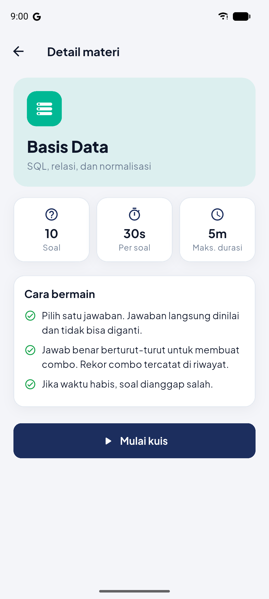
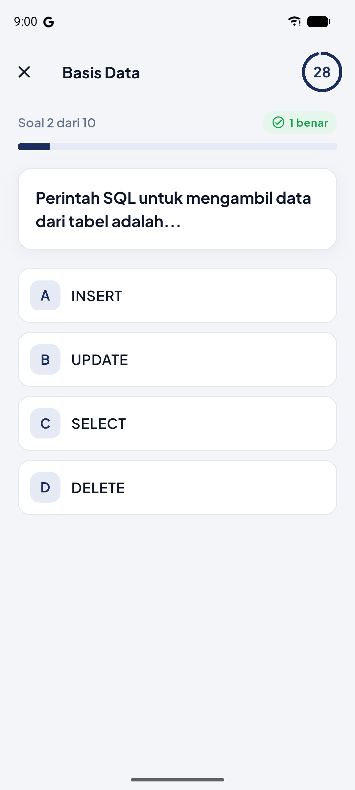
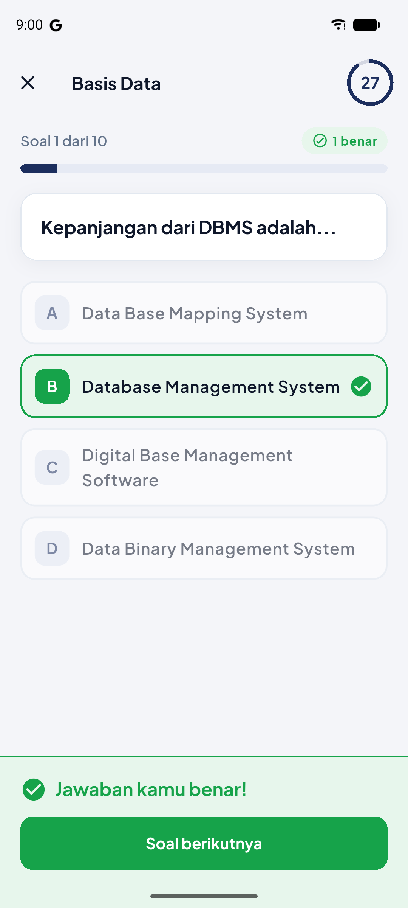
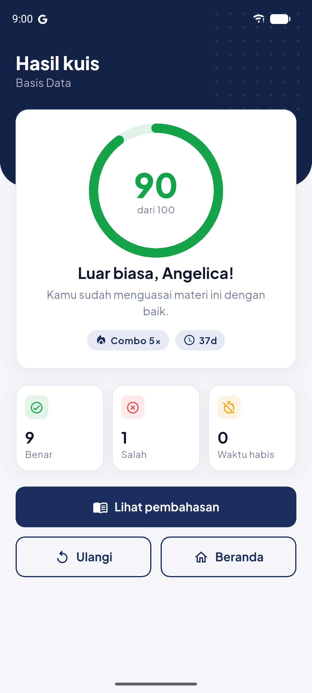
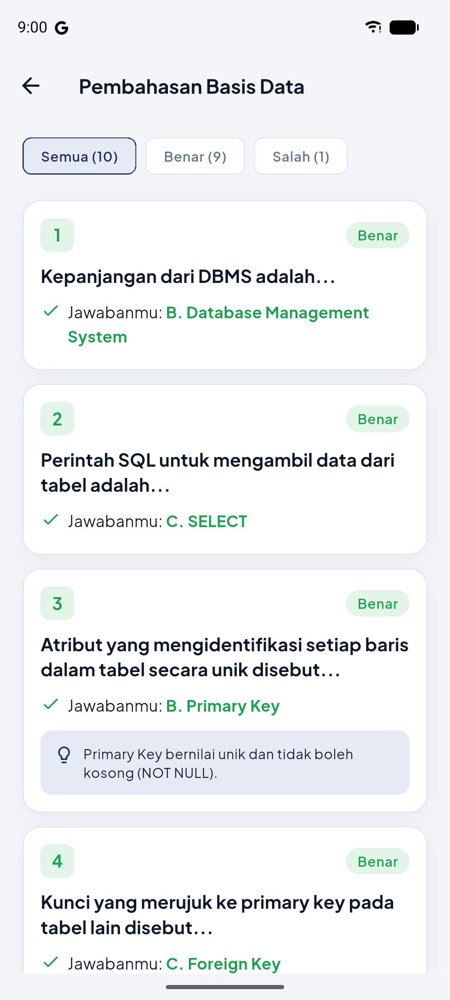
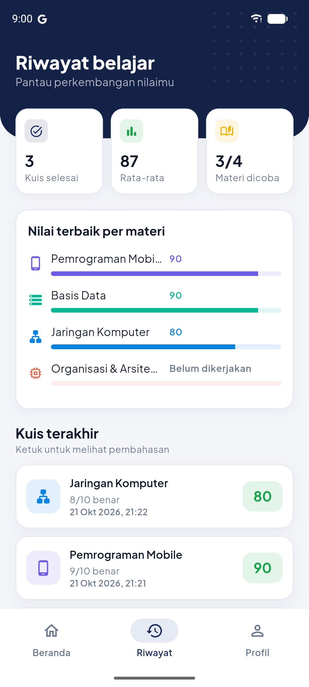
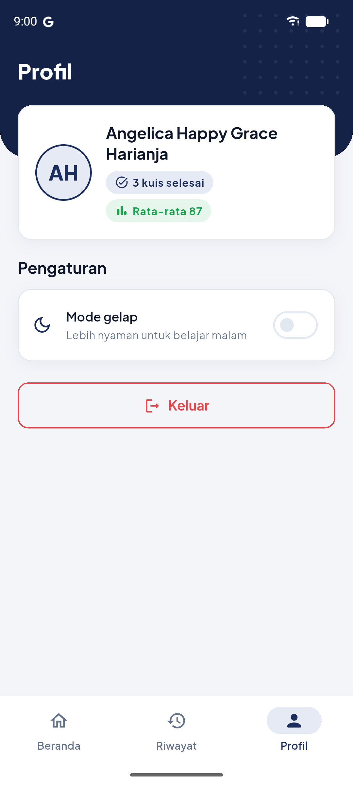
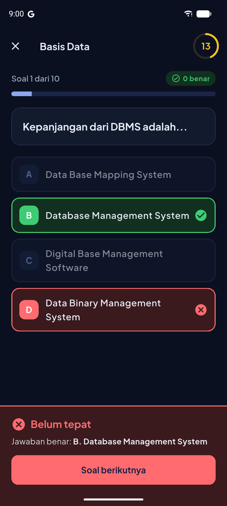
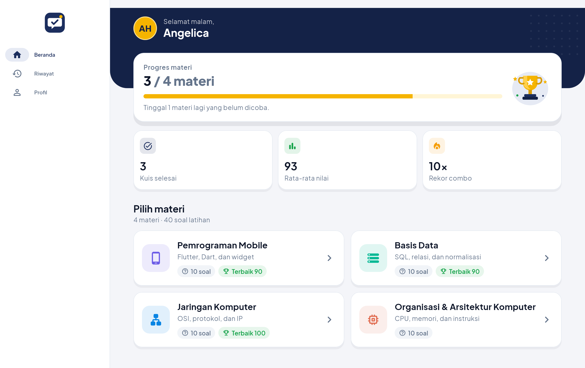

# Kuisin

Aplikasi kuis pilihan ganda untuk latihan materi Ilmu Komputer. Dibuat untuk UTS Lab Pemrograman Mobile, Semester Ganjil 2026/2027.

## Identitas Mahasiswa

- Nama: Angelica Happy Grace Harianja
- NIM: 241401130
- Lab: Lab 2 Pemrograman Mobile

## Informasi Aplikasi

### Nama Aplikasi

Kuisin

### Deskripsi Singkat

Kuisin adalah aplikasi latihan soal pilihan ganda. Pengguna memasukkan nama, memilih materi, lalu menjawab 10 soal dengan batas waktu per soal. Setiap jawaban langsung dinilai beserta pembahasannya, dan di akhir kuis pengguna melihat skor akhir atas namanya sendiri. Semua hasil tersimpan di riwayat.

Seluruh data (soal, nama pengguna, riwayat) disimpan lokal di memori aplikasi, tanpa database.

### Fitur

- Halaman sambutan dengan ilustrasi dan ringkasan fitur.
- Halaman isi nama dengan validasi (wajib diisi, minimal 3 huruf, hanya huruf).
- 4 materi, masing-masing 10 soal: Pemrograman Mobile, Basis Data, Jaringan Komputer, serta Organisasi dan Arsitektur Komputer.
- Halaman detail materi sebelum kuis dimulai: jumlah soal, waktu per soal, cara bermain, dan nilai terbaik sebelumnya.
- Timer 30 detik per soal. Jika waktu habis, soal dianggap salah.
- Feedback langsung setelah menjawab: jawaban benar dan salah ditandai, lengkap dengan kunci jawaban dan penjelasannya.
- Combo untuk jawaban benar berturut-turut, dan rekornya tercatat.
- Progres kuis tidak hilang saat layar dirotasi atau keluar ke beranda. Kuis bisa dilanjutkan lewat kartu "Lanjutkan kuis" di beranda, dan timer berhenti selama pengguna keluar.
- Halaman hasil: skor 0 sampai 100 dengan nama pengguna, jumlah benar, salah, dan waktu habis, combo terbaik, serta durasi.
- Halaman pembahasan semua soal, dengan filter Semua, Benar, dan Salah.
- Beranda: sapaan sesuai waktu, progres materi, jumlah kuis selesai, rata-rata nilai, dan rekor combo.
- Riwayat: rata-rata nilai, nilai terbaik per materi, dan daftar kuis terakhir yang bisa dibuka lagi pembahasannya.
- Profil: nama pengguna, ringkasan nilai, pengaturan mode gelap, dan tombol keluar.
- Mode terang dan gelap (bonus).
- Tampilan responsive dan adaptive untuk HP, tablet, dan web (bonus). Di HP memakai navigasi bawah, sedangkan di tablet dan web memakai navigasi samping dan tata letak dua kolom.

## Pemenuhan Kriteria

1. StatelessWidget dan StatefulWidget: StatefulWidget dipakai di LoginScreen, QuizScreen, ReviewScreen, MainShell, dan AppTextField. Halaman dan widget lainnya memakai StatelessWidget.
2. Minimal 2 halaman dan navigasi: Sambutan, Isi nama, Beranda, Riwayat, Profil, Detail materi, Kuis, Hasil, dan Pembahasan. Navigasi memakai named routes di lib/routes/app_routes.dart.
3. Reusable widget: semua widget yang dipakai berulang ada di folder lib/widgets, satu widget per file.
4. Aset gambar dan ikon: ilustrasi SVG di assets/images dan Material Icons.
5. Font kustom: Plus Jakarta Sans di assets/fonts.
6. Ukuran dinamis: ukuran elemen dihitung dari ukuran layar lewat lib/core/utils/responsive.dart.
7. State management: memakai provider (AuthProvider, QuizProvider, HistoryProvider, ThemeProvider), sehingga progres tidak hilang saat layar dirotasi atau berpindah halaman.
8. Tanpa database: soal disimpan di lib/data/quiz_data.dart, sedangkan nama pengguna dan riwayat disimpan di memori.

## Dokumentasi

### Credit Aset

- Font Plus Jakarta Sans oleh Tokotype (https://github.com/tokotype/PlusJakartaSans), lisensi SIL Open Font License 1.1.
- Ikon dari Material Icons (https://fonts.google.com/icons), lisensi Apache 2.0.
- Ilustrasi logo, welcome, trophy, dan empty dibuat sendiri untuk proyek ini.
- Package: provider, flutter_svg, dan fake_async (untuk test).

### Screenshot

Sambutan

Isi nama

Beranda

Detail materi

Kuis

Feedback jawaban

Hasil

Pembahasan

Riwayat

Profil

Kuis (mode gelap)

Beranda (web)

### Mockup / Prototype
Link : https://www.figma.com/design/Hcoz0v2agfsMpG1tQTwGQE/Prototype-Kuisin?node-id=0-1&t=2qOuk9Rh1hbKXGKy-1
